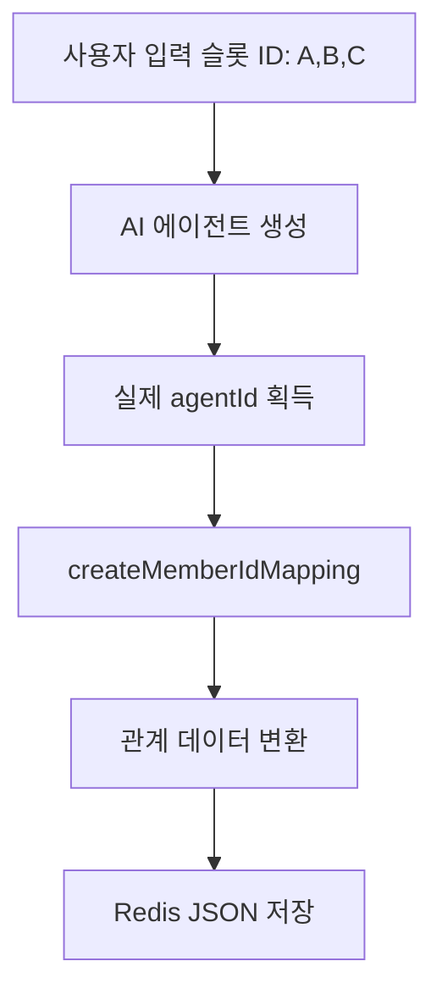
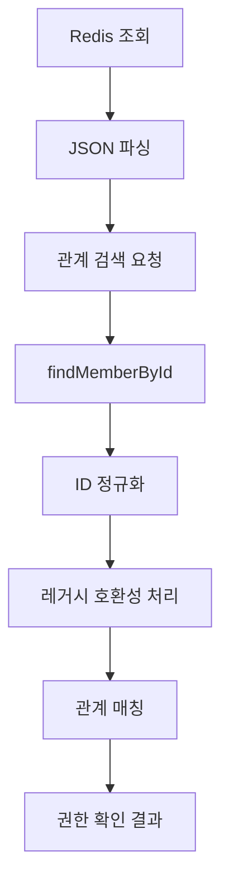

# CrafTeam 관계 시스템 종합 분석 및 최적화 계획

## 개요

CrafTeam 프로젝트의 관계(Relationship) 시스템에 대한 전체적인 분석과 호환성 문제 식별, 그리고 최적화 계획을 정리한 문서입니다.

---

## 1. 현재 관계 시스템 구조

### 1.1 관계 타입 정의 (`src/lib/types.ts`)

```typescript
export const RELATIONSHIP_TYPES = {
  PEER: { label: "Peer", color: "#374151", strokeWidth: 2 },
  SUPERVISOR: { label: "Superior-Subordinate", color: "#111827", strokeWidth: 2.5 },
  SUBORDINATE: { label: "Subordinate-Superior", color: "#111827", strokeWidth: 2.5 },
  NULL: { label: "No Relationship", color: "#9ca3af", strokeWidth: 1, hidden: true },
}

export interface Relationship {
  from: string;
  to: string;
  type: RelationshipType;
}
```

### 1.2 데이터 저장 구조

**팀 모델**:
```typescript
export interface Team {
  id: string;
  relationships: Relationship[];
  nodePositions?: { [key: string]: { x: number; y: number } };
  // ...
}
```

**Redis 저장 방식**:
- `relationships`: JSON 문자열로 직렬화 저장
- `nodePositions`: JSON 문자열로 직렬화 저장
- `team:${teamId}` 해시 키로 저장

### 1.3 주요 컴포넌트

1. **RelationshipGraph**: 편집 가능한 메인 그래프
2. **MiniRelationshipNetwork**: 읽기 전용 축소 그래프
3. **관계 유틸리티 함수들**: 권한 체크 및 관계 조회

---

## 2. 식별된 호환성 문제들

### 2.1 ID 매핑 불일치 문제 ⚠️ **CRITICAL**

**문제 설명**:
- 팀 생성 시: 슬롯 ID (A, B, C, D) → 실제 agentId로 변환 저장
- 사용 시: 다시 agentId → 슬롯 ID/이름 변환 필요
- 사용자 ID: "나" (레거시) vs "Me" (현재) 혼재

**발생 위치**:
```typescript
// 팀 생성 시 변환
const finalIdMapping = createMemberIdMapping(finalMemberSlots);
const finalRelationships = relationships.map(rel => ({
  from: finalIdMapping[rel.from] || rel.from,  // A → agent_xyz123
  to: finalIdMapping[rel.to] || rel.to,        // Me → Me
}));

// 사용 시 재변환
const fromMember = findMemberById(team, fromId);
const normalizedFromId = getMemberActualId(fromMember);
```

**영향**:
- 관계 검색 실패 가능성
- 권한 체크 오작동
- 그래프 렌더링 오류

### 2.2 JSON 파싱 일관성 문제 ⚠️ **HIGH**

**문제 설명**:
- Redis 저장/조회 시 JSON 직렬화/파싱 오류 가능
- 타입 불일치: 문자열 vs 객체
- 예외 처리 불충분

**발생 위치**:
```typescript
// 안전하지 않은 파싱
relationships = JSON.parse(teamData.relationships);

// 현재 안전 장치
try {
  if (typeof teamData.relationships === "string") {
    relationships = JSON.parse(teamData.relationships);
  }
} catch (error) {
  relationships = [];
}
```

### 2.3 그래프 렌더링 동기화 문제 ⚠️ **MEDIUM**

**문제 설명**:
- 메인 그래프와 미니 그래프 간 위치 동기화 불일치
- 서로 다른 좌표 시스템 사용
- 실시간 업데이트 지연

**발생 위치**:
- `RelationshipGraph`: 500px 높이 캔버스
- `MiniRelationshipNetwork`: 190x160px 고정 크기
- 좌표 변환 로직의 불일치

### 2.4 성능 최적화 문제 ⚠️ **MEDIUM**

**문제 설명**:
- 드래그 중 매 프레임마다 전체 SVG 리렌더링
- O(n²) 복잡도의 관계 계산
- 메모리 누수 가능성

**발생 위치**:
```typescript
// 매번 실행되는 무거운 계산
relationships.map((rel) => {
  const dx = toNode.x - fromNode.x;
  const dy = toNode.y - fromNode.y;
  const length = Math.sqrt(dx * dx + dy * dy);
});
```

### 2.5 접근성 및 사용성 문제 ⚠️ **LOW**

**문제 설명**:
- 키보드 네비게이션 미지원
- 화면 리더 호환성 부족
- 모바일 터치 이벤트 미지원

---

## 3. 현재 데이터 흐름 분석

### 3.1 팀 생성 플로우



### 3.2 관계 사용 플로우



---

## 4. 최적화 계획

### Phase 1: 핵심 호환성 문제 해결 🔥 **URGENT**

#### 4.1 ID 매핑 시스템 통합

**목표**: 일관된 ID 체계 구축

**구현 계획**:

1. **중앙집중식 ID 관리 서비스 생성**
```typescript
// src/lib/id-manager.ts
export class TeamIdManager {
  private team: Team;
  private idMapping: Map<string, string>;

  constructor(team: Team) {
    this.team = team;
    this.idMapping = this.buildIdMapping();
  }

  // 모든 ID 형태를 표준 ID로 변환
  normalizeId(id: string): string | null {
    return this.idMapping.get(id) || null;
  }

  // 역방향 변환도 지원
  getDisplayId(standardId: string): string {
    // agentId → display name 변환
  }
}
```

2. **관계 저장 형식 표준화**
```typescript
// 저장 시 항상 표준 ID 사용
interface NormalizedRelationship {
  from: string;  // 항상 "Me" 또는 agentId
  to: string;    // 항상 "Me" 또는 agentId
  type: RelationshipType;
  metadata?: {
    createdAt: string;
    createdBy: string;
  }
}
```

#### 4.2 JSON 파싱 안정성 강화

**목표**: 데이터 무결성 보장

**구현 계획**:

1. **타입 안전 파서 구현**
```typescript
// src/lib/safe-parser.ts
export function safeParseRelationships(data: unknown): Relationship[] {
  try {
    if (typeof data === 'string') {
      const parsed = JSON.parse(data);
      return validateRelationships(parsed);
    }
    if (Array.isArray(data)) {
      return validateRelationships(data);
    }
  } catch (error) {
    console.error('Relationship parsing error:', error);
  }
  return [];
}

function validateRelationships(data: any[]): Relationship[] {
  return data.filter(rel =>
    rel &&
    typeof rel.from === 'string' &&
    typeof rel.to === 'string' &&
    typeof rel.type === 'string'
  );
}
```

2. **스키마 검증 추가**
```typescript
// Zod 스키마 사용
const RelationshipSchema = z.object({
  from: z.string(),
  to: z.string(),
  type: z.enum(['PEER', 'SUPERVISOR', 'SUBORDINATE', 'NULL']),
});

const TeamSchema = z.object({
  relationships: z.array(RelationshipSchema),
  nodePositions: z.record(z.object({
    x: z.number(),
    y: z.number(),
  })).optional(),
});
```

### Phase 2: 성능 최적화 🚀 **HIGH PRIORITY**

#### 4.3 그래프 렌더링 최적화

**목표**: 60fps 유지, 메모리 사용량 50% 절감

**구현 계획**:

1. **가상화 및 LOD (Level of Detail) 구현**
```typescript
// src/components/OptimizedRelationshipGraph.tsx
interface ViewportBounds {
  minX: number; maxX: number;
  minY: number; maxY: number;
}

export function OptimizedRelationshipGraph() {
  const [viewport, setViewport] = useState<ViewportBounds>();

  // 뷰포트 내 노드만 렌더링
  const visibleNodes = useMemo(() =>
    nodes.filter(node => isNodeInViewport(node, viewport))
  , [nodes, viewport]);

  // 관계 선도 거리 기반 LOD 적용
  const visibleRelationships = useMemo(() =>
    relationships.filter(rel => shouldRenderRelationship(rel, viewport))
  , [relationships, viewport]);
}
```

2. **메모이제이션 전략**
```typescript
// 좌표 계산 결과 캐싱
const memoizedLineCalculation = useMemo(() => {
  const cache = new Map<string, LineGeometry>();

  return (fromNode: Node, toNode: Node) => {
    const key = `${fromNode.id}-${toNode.id}`;
    if (!cache.has(key)) {
      cache.set(key, calculateLineGeometry(fromNode, toNode));
    }
    return cache.get(key)!;
  };
}, []);
```

3. **렌더링 배치 처리**
```typescript
// 드래그 중 렌더링 throttling
const throttledRender = useCallback(
  throttle((positions: NodePositions) => {
    setNodes(positions);
  }, 16), // 60fps = 16ms
  []
);
```

#### 4.4 상태 관리 최적화

**목표**: 불필요한 리렌더링 제거

**구현 계획**:

1. **Context 분리**
```typescript
// 관계 데이터만 관리하는 전용 Context
export const RelationshipContext = React.createContext<{
  relationships: Relationship[];
  updateRelationship: (rel: Relationship) => void;
  removeRelationship: (from: string, to: string) => void;
}>();

// 그래프 시각화만 관리하는 Context
export const GraphVisualizationContext = React.createContext<{
  nodePositions: NodePositions;
  updateNodePosition: (id: string, position: Position) => void;
}>();
```

2. **메모이제이션 적용**
```typescript
// 관계 기반 권한 체크 결과 캐싱
const useRelationshipPermissions = (userId: string, targetId: string) => {
  return useMemo(() => ({
    canCreateFeedback: canCreateFeedbackSession(userId, targetId, team),
    canMakeRequest: canMakeRequest(userId, targetId, team),
    canEvaluateIdea: canEvaluateIdea(userId, targetId, team),
  }), [userId, targetId, team.relationships]);
};
```

### Phase 3: 사용성 및 접근성 향상 ♿ **MEDIUM PRIORITY**

#### 4.5 접근성 강화

1. **키보드 네비게이션**
```typescript
// 키보드 이벤트 핸들링
const handleKeyDown = useCallback((event: KeyboardEvent) => {
  switch (event.key) {
    case 'Tab':
      focusNextNode();
      break;
    case 'Enter':
    case ' ':
      if (selectedNode) {
        toggleNodeSelection(selectedNode);
      }
      break;
    case 'Escape':
      cancelSelection();
      break;
  }
}, [selectedNode]);
```

2. **ARIA 라벨링**
```typescript
// SVG 요소에 접근성 속성 추가
<svg role="img" aria-labelledby="graph-title" aria-describedby="graph-desc">
  <title id="graph-title">Team Relationship Graph</title>
  <desc id="graph-desc">
    Interactive graph showing relationships between {members.length} team members
  </desc>
  {/* 노드들 */}
  <circle
    role="button"
    aria-label={`${member.name}, ${getRelationshipSummary(member)}`}
    tabIndex={0}
  />
</svg>
```

3. **모바일 지원**
```typescript
// 터치 이벤트 추가
const handleTouchStart = useCallback((event: TouchEvent) => {
  const touch = event.touches[0];
  handlePointerStart({ clientX: touch.clientX, clientY: touch.clientY });
}, []);
```

### Phase 4: 확장성 및 모니터링 📊 **LOW PRIORITY**

#### 4.6 성능 모니터링

1. **메트릭 수집**
```typescript
// 성능 메트릭 수집
export const usePerformanceMetrics = () => {
  const [metrics, setMetrics] = useState<PerformanceMetrics>();

  useEffect(() => {
    const observer = new PerformanceObserver((list) => {
      const entries = list.getEntries();
      // 렌더링 시간, 메모리 사용량 등 수집
    });

    observer.observe({ entryTypes: ['measure', 'navigation'] });
  }, []);
};
```

2. **에러 추적**
```typescript
// 관계 시스템 전용 에러 바운더리
export class RelationshipErrorBoundary extends Component {
  componentDidCatch(error: Error, errorInfo: ErrorInfo) {
    // 관계 관련 오류를 별도로 추적
    trackRelationshipError(error, errorInfo);
  }
}
```

---

## 5. 구현 우선순위 및 일정

### Week 1-2: Phase 1 (핵심 호환성)
- [ ] TeamIdManager 구현
- [ ] 안전한 JSON 파서 구현
- [ ] ID 매핑 통합 테스트

### Week 3-4: Phase 2 (성능 최적화)
- [ ] 그래프 렌더링 최적화
- [ ] 메모이제이션 적용
- [ ] 성능 테스트 및 벤치마크

### Week 5-6: Phase 3 (사용성 향상)
- [ ] 키보드 네비게이션 구현
- [ ] ARIA 라벨링 추가
- [ ] 모바일 터치 지원

### Week 7-8: Phase 4 (모니터링)
- [ ] 성능 메트릭 수집
- [ ] 에러 추적 시스템
- [ ] 문서화 및 가이드 작성

---

## 6. 성공 지표

### 성능 지표
- 드래그 반응성: 60fps 유지
- 초기 로딩 시간: 2초 → 1초
- 메모리 사용량: 50% 절감

### 안정성 지표
- 관계 검색 실패율: 0%
- JSON 파싱 오류율: 0%
- 사용자 세션 에러율: < 0.1%

### 사용성 지표
- 키보드 네비게이션 완성도: 100%
- 화면 리더 호환성: WCAG 2.1 AA 준수
- 모바일 사용성 점수: 90점 이상

---

## 7. 위험 요소 및 대응책

### 기술적 위험
1. **기존 데이터 마이그레이션 실패**
   - 대응: 단계적 마이그레이션 + 롤백 계획
2. **성능 최적화 부작용**
   - 대응: A/B 테스트 + 점진적 배포
3. **호환성 문제 발생**
   - 대응: 레거시 모드 지원 + 충분한 테스트

### 일정 위험
1. **개발 지연**
   - 대응: MVP 우선 구현 + 단계적 기능 추가
2. **테스트 시간 부족**
   - 대응: TDD 적용 + 자동화 테스트 강화

---

이 계획을 통해 CrafTeam의 관계 시스템을 안정적이고 확장 가능한 구조로 개선할 수 있을 것입니다.